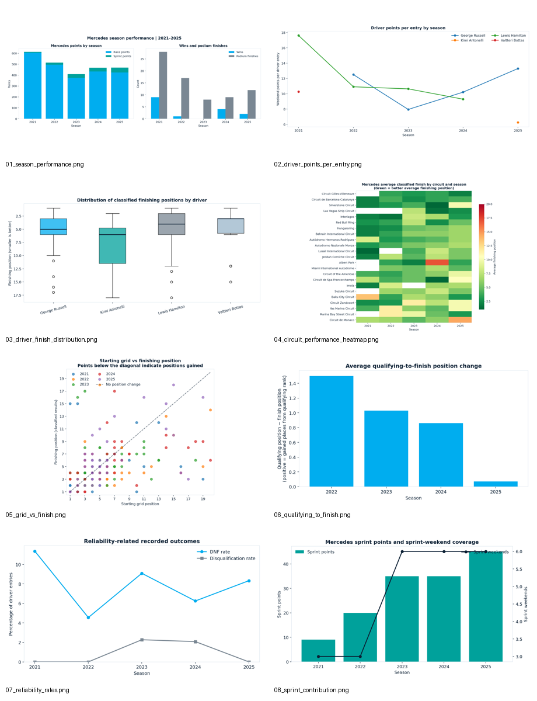

# Mercedes F1 Analytics (2021–2025)

**By Aarsh Shrivas** · Python · Pandas · NumPy · Matplotlib · Seaborn · SciPy · MySQL · Power BI

An end-to-end sports analytics portfolio project exploring Mercedes Formula 1 driver and team performance across the 2021–2025 seasons. The repository brings together data cleaning, exploratory analysis, SQL queries, summary exports, charts, and a Power BI report.



## Project components

- **Data cleaning and validation:** documents data-quality checks and explicit fixes while preserving the supplied workbook.
- **Exploratory data analysis:** compares season performance, drivers, qualifying and race results, circuits, and reliability-related outcomes.
- **SQL analysis:** includes queries for data-quality checks, season and driver points, rankings, starting-grid groups, circuit comparisons, and DNF rates.
- **Power BI:** includes the `.pbix` report for interactive performance exploration.
- **Reproducible outputs:** the current notebook writes refreshed tables and charts to `outputs/tables/` and `outputs/figures/`. Earlier supplied exports are kept separately under `outputs/reference_exports/` so they are not confused with outputs regenerated by this notebook.

## Repository structure

```text
Mercedes-F1-Analytics/
├── data/
│   └── Mercedes_F1_2021-2025_Merged.xlsx
├── notebooks/
│   └── Mercedes_F1_Complete_Analysis_Final.ipynb
├── sql/
│   └── F1_mercsqldata.sql
├── power_bi/
│   └── Mercedes_F1.pbix
├── outputs/
│   ├── figures/             # refreshed by the current notebook
│   ├── tables/              # refreshed by the current notebook
│   └── reference_exports/   # earlier supplied figures, tables, and findings
│       ├── figures/
│       ├── tables/
│       └── reports/
├── docs/
│   └── images/
├── requirements.txt
└── README.md
```

## Run the Python notebook

Recommended: Python 3.10 or newer.

1. Download or clone this repository and open a terminal in the repository folder.
2. (Optional but recommended) create and activate a virtual environment.
3. Install the dependencies:

   ```bash
   pip install -r requirements.txt
   ```

4. Start JupyterLab:

   ```bash
   jupyter lab
   ```

5. Open `notebooks/Mercedes_F1_Complete_Analysis_Final.ipynb` and run the cells from top to bottom.

The notebook searches the project folder and its parent folders for the workbook in `data/`. It writes the cleaned dataset, cleaning log, summary CSVs, and chart images under `outputs/tables/` and `outputs/figures/`.

## Run the SQL analysis

The SQL script targets **MySQL 8.0 or newer** and expects an imported table named `f1merc_data` in database `F1`.

1. Run the Python notebook first so `outputs/tables/mercedes_clean.csv` is created.
2. In MySQL Workbench, create/select the `F1` database and use **Table Data Import Wizard** to import that CSV as `f1merc_data`. Check that numeric columns are imported as numeric types, and text/date columns as appropriate.
3. Open `sql/F1_mercsqldata.sql` and execute the queries after the table import has completed.

The script contains data-quality checks and descriptive queries; result tables depend on the imported data and MySQL schema.

## Open the Power BI report

Open `power_bi/Mercedes_F1.pbix` in Power BI Desktop. If Power BI requests a data-source path or credentials, reconnect it to the appropriate local dataset and refresh. The report file has been included, but a refresh on another computer has not been verified in this package.

## Scope and limitations

- The analysis covers the supplied **Mercedes-only** dataset from 2021 through 2025; it is not a full-grid comparison of all constructors.
- The workbook contains 228 driver-weekend records. Most race weekends have two Mercedes driver entries.
- Standard qualifying fields are unavailable for 2021, so qualifying comparisons use available data only.
- The source data does not provide detailed pit-stop timing, tyre stints/compounds, lap-by-lap timing, telemetry, weather, safety-car details, or retirement causes. This project therefore does not infer those variables.
- Descriptive statistics and correlations indicate patterns, not causation. Small differences by circuit should be interpreted carefully given the number of starts.
- Cleaning changes are documented in the notebook and its `cleaning_log.csv` output; the original workbook is kept unchanged.

## Data attribution

The supplied workbook identifies this repository as its data source: [toUpperCase78/formula1-datasets](https://github.com/toUpperCase78/formula1-datasets). A 2025 Austrian Grand Prix date correction is documented in the data-cleaning notebook; the original workbook remains unchanged.

## Suggested next improvements

- Add a Power BI screenshot after opening and verifying the report on your machine.
- Add a small `LICENSE` file only after deciding the license for your original code and checking the source data's reuse terms.
- Add a GitHub release/tag once the repository has been verified end to end.
